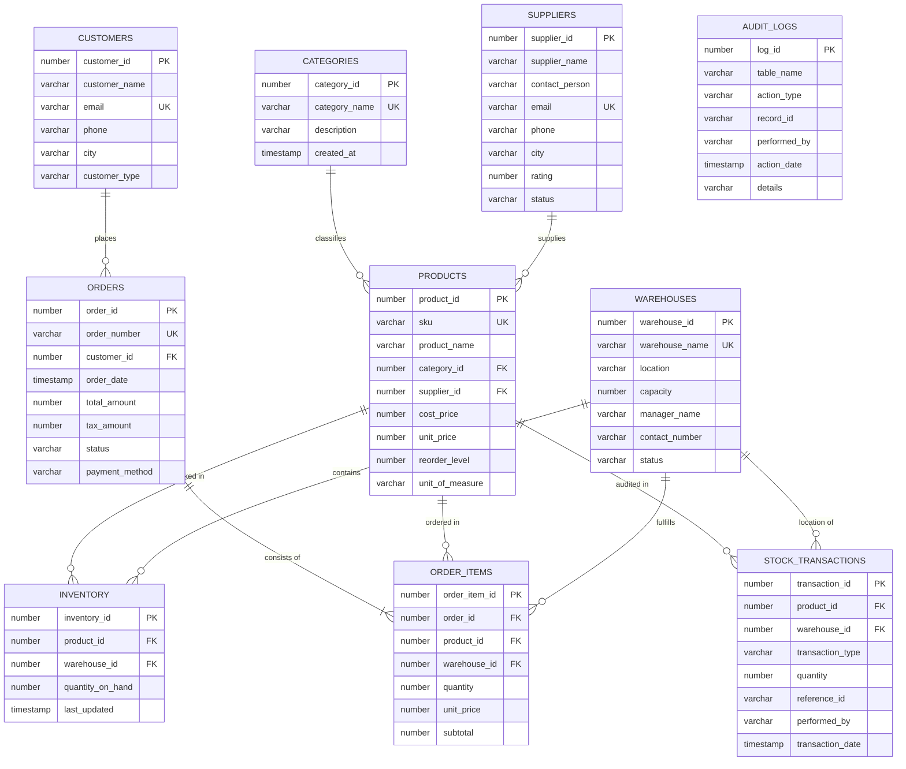

# 📦 ApexStock Enterprise — Inventory Management System
> **Database Management Systems (DBMS) Mini Project**  
> **Database:** Oracle SQL (Oracle 23ai / 21c / 19c)  
> **Interface:** Python 3.10+ & Streamlit  
> **Architecture:** 3-Tier Enterprise Architecture (Client UI $\leftrightarrow$ Python Data Access Layer $\leftrightarrow$ Oracle Database Engine)

---

## 🌟 Table of Contents
1. [Project Overview](#-project-overview)
2. [DBMS Concepts Covered](#-dbms-concepts-covered)
3. [Entity-Relationship (ER) Diagram](#-entity-relationship-er-diagram)
4. [Relational Schema & Integrity Constraints](#-relational-schema--integrity-constraints)
5. [SQL Modules Breakdown](#-sql-modules-breakdown)
   - [DDL (Data Definition Language)](#1-ddl-data-definition-language)
   - [DML (Data Manipulation Language & CRUD)](#2-dml-data-manipulation-language--crud)
   - [SQL Queries & Analytics](#3-sql-queries--analytics)
   - [DCL (Data Control Language & Security)](#4-dcl-data-control-language--security)
   - [PL/SQL Stored Procedures & Triggers](#5-plsql-stored-procedures-functions--triggers)
6. [Streamlit UI Features & Design System](#-streamlit-ui-features--design-system)
7. [Installation & Setup Instructions](#-installation--setup-instructions)
8. [Step-by-Step Project Demonstration Guide (Viva Guide)](#-step-by-step-project-demonstration-guide-viva-guide)
9. [Portfolio Website & Cloud Deployment (Render)](#-portfolio-website--cloud-deployment)

---

## 📋 Project Overview

**ApexStock Enterprise** is an industrial-grade **Inventory Management System (IMS)** designed to manage enterprise supply chains, multi-facility warehouse stock, automated reordering, vendor procurement, and point-of-sale customer billing.

The system interfaces a **Python + Streamlit** frontend with an **Oracle SQL Database** using Oracle's high-speed `python-oracledb` connector in thin mode.

### Key Highlights
- **10 Core Relational Tables** with comprehensive PK, FK, UNIQUE, and CHECK constraints.
- **5 Predefined Analytical Views** calculating live margins, stock valuations, and reorder deficits.
- **PL/SQL Stored Procedures & Triggers** for atomic stock transactions, inter-warehouse transfers, and DML audit trails.
- **Role-Based Access Control (DCL)** with granular `GRANT` and `REVOKE` privileges verified through Oracle's Data Dictionary (`USER_TAB_PRIVS_MADE`).
- **Interactive SQL Workbench** enabling viva examiners to execute arbitrary queries live or run curated DBMS demonstration templates.
- **Modern UI** built with custom CSS, real-time KPI metric cards, and responsive Plotly visual analytics.

---

## 🎯 DBMS Concepts Covered

| Concept | Implementation in Project |
| :--- | :--- |
| **DDL** | `CREATE TABLE`, `ALTER TABLE`, `DROP TABLE`, Constraints (`PRIMARY KEY`, `FOREIGN KEY`, `CHECK`, `UNIQUE`, `NOT NULL`), Identity Sequences, `CREATE VIEW`, `CREATE TRIGGER`. |
| **DML** | `INSERT`, `UPDATE`, `DELETE`, `MERGE` (Upsert), `SELECT` with filtering and sorting. |
| **CRUD Operations** | Complete interface to Create, Read, Update, and Delete across Products, Categories, Warehouses, Suppliers, Customers, and Orders. |
| **Multi-Table Joins** | 2-way, 3-way, and 4-way `INNER JOIN`, `LEFT OUTER JOIN`, `CROSS JOIN`, and expression joins. |
| **Aggregations** | `COUNT`, `SUM`, `AVG`, `MIN`, `MAX` with `GROUP BY` and `HAVING` clauses. |
| **Subqueries** | Non-correlated subqueries, correlated subqueries, and `EXISTS` predicates. |
| **Set Operators** | `UNION ALL` and `MINUS`. |
| **Analytic Functions** | `DENSE_RANK() OVER (PARTITION BY ...)`, `SUM() OVER (ORDER BY ... ROWS BETWEEN ...)`, `RATIO_TO_REPORT()`. |
| **DCL & Security** | `CREATE ROLE`, `GRANT`, `REVOKE`, Role assignment, querying Data Dictionary catalogs. |
| **PL/SQL & Triggers** | Stored procedures with `IN`/`OUT` parameters, transaction control (`COMMIT`/`ROLLBACK`), row-level triggers. |

---

## 🗺️ Entity-Relationship (ER) Diagram



---

## 🏛️ Relational Schema & Integrity Constraints

| Table | Primary Key | Foreign Keys | Key Constraints & Checks |
| :--- | :--- | :--- | :--- |
| `CATEGORIES` | `category_id` | *None* | `UNIQUE(category_name)` |
| `SUPPLIERS` | `supplier_id` | *None* | `UNIQUE(email)`, `CHECK (rating BETWEEN 1 AND 5)`, `CHECK (status IN ('ACTIVE','INACTIVE'))` |
| `WAREHOUSES` | `warehouse_id` | *None* | `UNIQUE(warehouse_name)`, `CHECK (capacity > 0)` |
| `CUSTOMERS` | `customer_id` | *None* | `UNIQUE(email)`, `CHECK (customer_type IN ('RETAIL','WHOLESALE','CORPORATE'))` |
| `PRODUCTS` | `product_id` | `category_id`, `supplier_id` | `UNIQUE(sku)`, `CHECK (cost_price >= 0)`, `CHECK (unit_price >= cost_price)` |
| `INVENTORY` | `inventory_id` | `product_id`, `warehouse_id` | `UNIQUE(product_id, warehouse_id)`, `CHECK (quantity_on_hand >= 0)` |
| `ORDERS` | `order_id` | `customer_id` | `UNIQUE(order_number)`, `CHECK (total_amount >= 0)`, `CHECK (status IN ('PENDING','PROCESSING','COMPLETED','CANCELLED'))` |
| `ORDER_ITEMS` | `order_item_id`| `order_id`, `product_id`, `warehouse_id` | `CHECK (quantity > 0)`, `CHECK (unit_price >= 0)`, `CHECK (subtotal >= 0)` |
| `STOCK_TRANSACTIONS` | `transaction_id` | `product_id`, `warehouse_id` | `CHECK (transaction_type IN ('STOCK_IN','STOCK_OUT','TRANSFER_IN','TRANSFER_OUT','ADJUSTMENT'))` |
| `AUDIT_LOGS` | `log_id` | *None* | `CHECK (action_type IN ('INSERT','UPDATE','DELETE'))` |

---

## 📁 Project Directory Structure

```
Mini-Pro/
│
├── sql/
│   ├── 01_ddl_schema.sql             # Tables, constraints, views, and triggers
│   ├── 02_dml_seed_data.sql          # Enterprise sample dataset
│   ├── 03_sql_queries.sql            # Academic demonstration SQL queries
│   ├── 04_dcl_permissions.sql        # Roles, GRANT, REVOKE, dictionary checks
│   ├── 05_stored_procedures.sql      # PL/SQL Stored Procedures & Functions
│   └── 06_cleanup_drop_all.sql       # Safe drop / clean reset script
│
├── database/
│   ├── connection.py                 # Oracle connection manager (oracledb)
│   ├── db_init.py                    # Schema migrator & SQL script runner
│   ├── dml_manager.py                # CRUD repository for all entities
│   ├── query_service.py              # Query runner & demonstration queries
│   └── dcl_service.py                # Security roles & privilege manager
│
├── ui/
│   ├── styles.py                     # Custom CSS design system
│   ├── components.py                 # Reusable UI widgets, cards & badges
│   └── views/
│       ├── dashboard_view.py         # Real-time analytics & Plotly charts
│       ├── products_view.py          # Products & Categories CRUD
│       ├── warehouses_view.py        # Facilities & Stock Matrix (MERGE)
│       ├── orders_view.py            # Sales Orders & POS Billing Cart
│       ├── stock_movement_view.py    # Stock In, Out & Warehouse Transfers
│       ├── partners_view.py          # Suppliers & Customers CRUD
│       ├── sql_workbench_view.py     # Live SQL Console & Concept Demos
│       ├── dcl_security_view.py      # RBAC, GRANT/REVOKE & Audit Logs
│       └── settings_view.py          # DB Diagnostics & 1-Click Re-seeder
│
├── portfolio/                        # 🌐 Render-Deploy-Ready Project Portfolio Website
│   ├── index.html                    # Interactive showcase & simulated SQL workbench
│   ├── css/style.css                 # Enterprise dark navy design system
│   ├── js/main.js                    # Interactive query runner, ERD modals & animations
│   ├── render.yaml                   # Render.com Blueprint deployment file
│   ├── server.js                     # Node.js Express production server
│   ├── server.py                     # Python HTTP server fallback
│   └── DEPLOY.md                     # 2-minute cloud deployment instructions
│
├── config.py                         # Application configuration
├── app.py                            # Main Streamlit application
├── requirements.txt                  # Python dependencies
├── .env                              # Active Oracle connection credentials
├── .env.example                      # Template for credentials
├── run_app.bat                       # One-click Windows batch launcher
├── run_app.ps1                       # One-click PowerShell launcher
└── README.md                         # Project documentation
```

---

## 💻 SQL Modules Breakdown

### 1. DDL (Data Definition Language)
Found in [`sql/01_ddl_schema.sql`](sql/01_ddl_schema.sql):
- Creates 10 relational tables with automatic identity sequencing (`GENERATED BY DEFAULT AS IDENTITY`).
- Defines relational integrity constraints: Primary keys, Foreign keys with `ON DELETE CASCADE` and `ON DELETE SET NULL`, `CHECK` constraints (e.g. `unit_price >= cost_price`), and `UNIQUE` constraints.
- Creates 5 analytical views:
  - `VW_PRODUCT_STOCK_SUMMARY`: Live catalog stock totals and profit margin percentages.
  - `VW_LOW_STOCK_ALERTS`: Automatically filters products at or below `reorder_level`.
  - `VW_WAREHOUSE_OCCUPANCY`: Calculates percentage warehouse space utilization.
  - `VW_SALES_ANALYTICS`: Orders breakdown by customer segment.
  - `VW_SUPPLIER_RATINGS`: Vendor fulfillment and inventory holdings.
- Creates database triggers:
  - `TRG_AUDIT_PRODUCT_CHANGES`: Fires `AFTER UPDATE OF unit_price, cost_price` on `PRODUCTS` and logs old vs new prices to `AUDIT_LOGS`.
  - `TRG_AUDIT_PRODUCT_DELETE`: Fires `BEFORE DELETE` to archive deleted records.

### 2. DML (Data Manipulation Language & CRUD)
Found in [`sql/02_dml_seed_data.sql`](sql/02_dml_seed_data.sql) and implemented in [`database/dml_manager.py`](database/dml_manager.py):
- **INSERT**: Adding new products, categories, suppliers, warehouses, and customer orders.
- **SELECT**: Parameterized search, multi-table joins, and stock matrix calculations.
- **UPDATE**: Updating product prices, vendor contact details, and warehouse status.
- **DELETE**: Removing products or suppliers with cascade safety and audit triggers.
- **MERGE (Upsert)**: Executed in the Stock Adjustment tab to atomically insert new inventory or update existing inventory quantities without separate query lookups.

### 3. SQL Queries & Analytics
Found in [`sql/03_sql_queries.sql`](sql/03_sql_queries.sql):
- **Multi-Table Joins**:
  - 4-Way `INNER JOIN` combining `PRODUCTS`, `CATEGORIES`, `INVENTORY`, and `WAREHOUSES`.
  - `LEFT OUTER JOIN` showing all warehouses even if zero inventory is allocated.
- **Aggregations & Grouping**:
  - Category-level gross profit margin and inventory valuation using `SUM`, `AVG`, and `GROUP BY`.
  - `HAVING` clause filtering warehouses whose stock exceeds 100 units.
- **Subqueries**:
  - Non-correlated subquery: Products priced above the overall catalog average.
  - Correlated subquery: Finding the most expensive product in each category.
  - `EXISTS` subquery: Suppliers providing products currently at low-stock alert status.
- **Set Operations**:
  - `UNION ALL`: Polymorphic stakeholder contact book combining Customers and Suppliers.
  - `MINUS`: Warehouses having no stock-outs.
- **Analytic / Window Functions**:
  - `DENSE_RANK() OVER (PARTITION BY category_id ORDER BY unit_price DESC)`: Ranking products by price within their respective categories.
  - Cumulative Running Total using `SUM(total_amount) OVER (ORDER BY order_date ROWS BETWEEN UNBOUNDED PRECEDING AND CURRENT ROW)`.
  - `RATIO_TO_REPORT(quantity_on_hand) OVER (PARTITION BY product_id)`: Ratio of stock distributed across warehouses.

### 4. DCL (Data Control Language & Security)
Found in [`sql/04_dcl_permissions.sql`](sql/04_dcl_permissions.sql) and [`database/dcl_service.py`](database/dcl_service.py):
- Creates Role-Based Access Control (RBAC) roles:
  1. `INV_ADMIN_ROLE`: Full DDL and DML access across all tables.
  2. `INV_MANAGER_ROLE`: DML access on catalog and inventory; cannot delete products.
  3. `INV_STAFF_ROLE`: Billing cashier permissions; `SELECT` on products and `INSERT` on orders.
  4. `INV_AUDITOR_ROLE`: Read-only access across tables, views, and audit logs.
- Demonstrates `GRANT` and `REVOKE` syntax.
- Live inspection of granted permissions via Oracle's Data Dictionary view `USER_TAB_PRIVS_MADE`.

### 5. PL/SQL Stored Procedures, Functions & Triggers
Found in [`sql/05_stored_procedures.sql`](sql/05_stored_procedures.sql):
- `SP_PROCESS_STOCK_MOVEMENT`: Handles inbound (`STOCK_IN`) and outbound (`STOCK_OUT`) inventory changes with validation against negative stock levels.
- `SP_TRANSFER_STOCK`: Atomically transfers units between two warehouses using an Oracle transaction with lock row protection (`SELECT ... FOR UPDATE`), ensuring consistency.
- `FN_GET_STOCK_HEALTH`: Function returning stock status (`CRITICAL_OUT_OF_STOCK`, `LOW_STOCK_WARNING`, `OPTIMAL`, `OVERSTOCKED`).
- `FN_GET_PRODUCT_VALUATION`: Evaluates inventory cost or retail valuation for any product.

---

## 🎨 Streamlit UI Features & Design System

The application features a dark-navy corporate design system (`ui/styles.py`):
1. **📊 Executive Dashboard**: KPI cards for Total Products, Stock Units, Retail Valuation, Low Stock Alerts, and Revenue. Includes interactive Plotly donut charts and warehouse capacity bars.
2. **📦 Products & Catalog (CRUD)**: Tabular catalog with live text search, category and supplier filters, "Add Product" form with price check validation, and "Edit/Delete" capabilities.
3. **🏢 Warehouses & Stock Matrix**: Facility occupancy meters, a two-dimensional product-by-warehouse stock matrix, and direct MERGE upserts.
4. **🛒 Orders & POS Billing**: Shopping cart interface allowing selection of customer, fulfillment warehouse, and quantities with real-time stock validation, automated tax calculation (8%), and formatted printable invoices.
5. **🔄 Stock Movements & Transfers**: Tabbed interface to receive purchase inventory, dispatch goods, and execute PL/SQL inter-warehouse stock transfers.
6. **👥 Suppliers & Customers**: Full CRUD management for business partners, credit ratings, and corporate classifications.
7. **📜 SQL Workbench & DBMS Demo**: Academic showcase containing pre-built DBMS demonstration queries with explanations, plus an interactive SQL console to execute custom queries.
8. **🛡️ DCL, Roles & Audit Security**: RBAC matrix, interactive `GRANT` and `REVOKE` command runner, and trigger audit logs.
9. **⚙️ Database Settings & Diagnostics**: Live Oracle ping, version banner display, and a 1-click database reset and re-seeding tool.

---

## 🚀 Installation & Setup Instructions

### Prerequisites
1. **Python 3.10 or higher** installed.
2. **Oracle Database** (Oracle 23ai Free, Oracle 21c Express Edition, or Oracle Cloud Free Tier).  
   *Note: On this workstation, Oracle 23ai Free is already running locally on `localhost:1521/FREEPDB1`.*

### Step 1: Install Python Dependencies
Open PowerShell or Command Prompt in the project folder and run:
```bash
pip install -r requirements.txt
```

### Step 2: Configure Database Connection
The `.env` file is pre-configured for local Oracle 23ai:
```ini
ORACLE_USER=inv_admin
ORACLE_PASSWORD=Inventory123#
ORACLE_HOST=localhost
ORACLE_PORT=1521
ORACLE_SERVICE_NAME=FREEPDB1
```

*(Optional)* If setting up on a fresh Oracle installation, run the following command in SQL*Plus as `SYSDBA` to create the user:
```sql
ALTER SESSION SET CONTAINER = FREEPDB1;
CREATE USER inv_admin IDENTIFIED BY "Inventory123#" DEFAULT TABLESPACE USERS QUOTA UNLIMITED ON USERS;
GRANT CONNECT, RESOURCE, DBA TO inv_admin;
```

### Step 3: Initialize Database Schema & Seed Data
Initialize the database tables, views, procedures, and sample data with:
```bash
python -m database.db_init
```

### Step 4: Launch the Streamlit Web Application
Run the launcher:
```bash
python -m streamlit run app.py
```
Or double-click `run_app.bat`.

The application will launch in your browser at:  
👉 **`http://localhost:8501`**

---

## 🎓 Step-by-Step Project Demonstration Guide (Viva Guide)

When presenting this project to your faculty, examiner, or viva committee, follow this structured demonstration sequence:

### 1. Show Database Connectivity & Architecture
- Open **⚙️ Database Settings & Diagnostics**.
- Point out the **Oracle Database Banner** (Oracle 23ai Free Release 23.26.3.0.0), connected user (`inv_admin`), and active table count (10 tables).
- Explain that the application uses the Oracle thin driver with parameterization to prevent SQL injection.

### 2. Demonstrate DDL & Schema Constraints
- Open **📜 SQL Workbench & DBMS Demo** $\rightarrow$ **🔍 Schema & Data Dictionary Explorer**.
- Select the `PRODUCTS` table to showcase columns and data types.
- Open the **Constraints** sub-tab to demonstrate:
  - Primary Key (`product_id`)
  - Unique Constraint (`sku`)
  - Check Constraint (`chk_price_gte_cost`: ensures `unit_price >= cost_price`)
  - Foreign Keys referencing `CATEGORIES` and `SUPPLIERS`.

### 3. Demonstrate Full CRUD Operations (DML)
- Open **📦 Products & Catalog (CRUD)**.
  - **Create (Insert)**: Go to **➕ Add New Product**. Try entering a unit price lower than the cost price to demonstrate the validation check. Then enter valid data (e.g., SKU: `SKU-DEMO-01`, Unit Price: `$99.00`, Cost: `$50.00`) and submit.
  - **Read (Select)**: Go to **📋 Product Catalog** and search for `SKU-DEMO-01`.
  - **Update**: Go to **✏️ Edit / Delete Product**, update the unit price to `$119.00`, and save.
  - **Audit Trigger Verification**: Open **🛡️ DCL, Roles & Audit Security** $\rightarrow$ **📜 System Audit Trail** to demonstrate that Oracle trigger `TRG_AUDIT_PRODUCT_CHANGES` captured the old and new price.

### 4. Demonstrate Advanced SQL Queries
- Open **📜 SQL Workbench & DBMS Demo** $\rightarrow$ **💡 DBMS Concept Demonstrations**.
- Run each curated concept:
  1. **Multi-Table Joins**: 3-Way Join connecting products, categories, inventory, and warehouses.
  2. **Aggregations & HAVING**: Warehouses with stock exceeding 100 units.
  3. **Subqueries**: Correlated subquery selecting the most expensive product per category.
  4. **Window Functions**: `DENSE_RANK() OVER (PARTITION BY category_id ORDER BY unit_price DESC)` ranking products within categories.
  5. **Set Operators**: `UNION ALL` creating a unified contact book.

### 5. Demonstrate Transactional Sales Order & POS Billing
- Open **🛒 Orders & POS Billing** $\rightarrow$ **⚡ Create New Sales Order**.
- Select a customer (e.g., `Alexander Wright`), select a product, choose the warehouse, specify a quantity, and click **➕ Add to Cart**.
- Click **🚀 Place Order & Deduct Inventory (COMMIT)**.
- Explain the ACID transaction:
  1. Validates stock availability.
  2. Inserts record into `ORDERS`.
  3. Inserts items into `ORDER_ITEMS`.
  4. Deducts quantity from `INVENTORY`.
  5. Records the outbound movement in `STOCK_TRANSACTIONS`.
- View the generated invoice in the **📋 Orders Ledger & Invoices** tab.

### 6. Demonstrate PL/SQL Stored Procedures
- Open **🔄 Stock Movements & Transfers** $\rightarrow$ **🚚 Warehouse Transfer (PL/SQL)**.
- Transfer 5 units of `MasterKey Mechanical Keyboard` from *Central Mega-Hub* to *West Coast Distribution*.
- Explain how PL/SQL procedure `SP_TRANSFER_STOCK` locks rows with `FOR UPDATE`, verifies availability, and atomically executes both legs of the transfer with rollback protection.

### 7. Demonstrate DCL (Data Control Language)
- Open **🛡️ DCL, Roles & Audit Security**.
- Show the **RBAC Privilege Matrix** explaining the Separation of Duties between Admin, Manager, Staff, and Auditor.
- Open **🔍 Data Dictionary (USER_TAB_PRIVS_MADE)** to show real permissions stored in Oracle's data dictionary.
- Open **⚡ Interactive GRANT / REVOKE Runner** to execute a live `GRANT` or `REVOKE` command and show the updated catalog.

---

## 🌐 Portfolio Website & Cloud Deployment

An interactive showcase and presentation website is available in the [`portfolio/`](portfolio/) directory.

### Quick Local Launch:
```bash
cd portfolio
npm install && npm start
# Or using Python:
python server.py
```
Open 👉 `http://localhost:3000`

### Cloud Deployment (Render.com):
The portfolio is **Render Deploy Ready** out-of-the-box via `portfolio/render.yaml` or Render Static Sites. Refer to [`portfolio/DEPLOY.md`](portfolio/DEPLOY.md) for full instructions.
